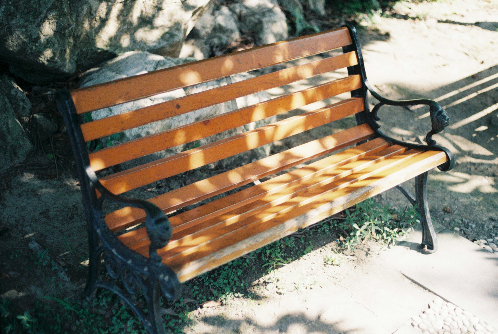
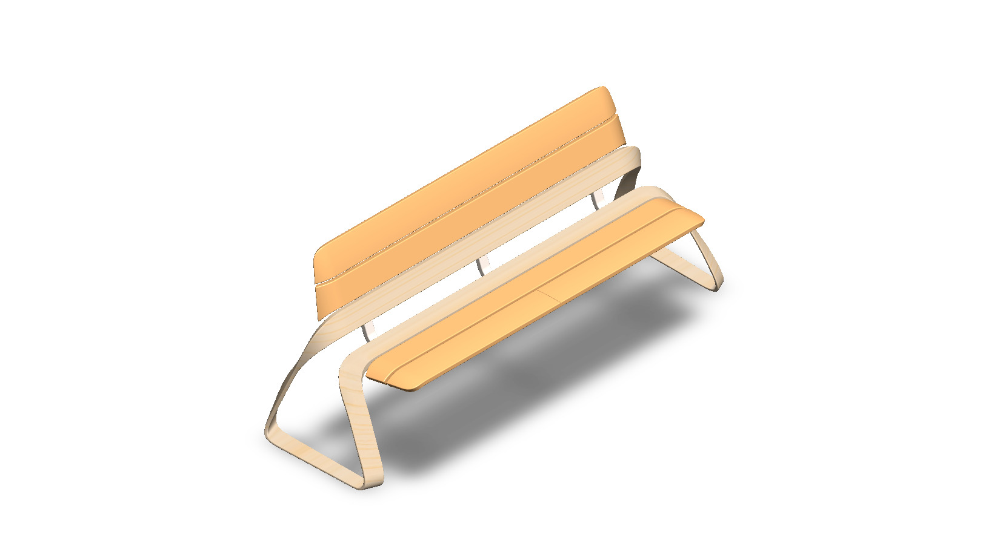
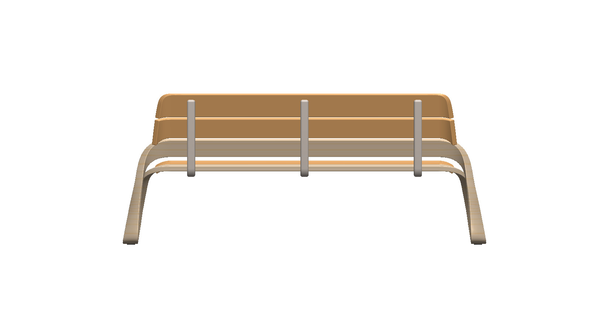
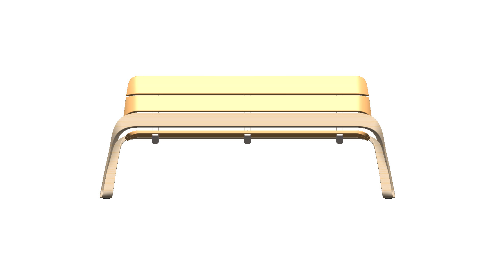
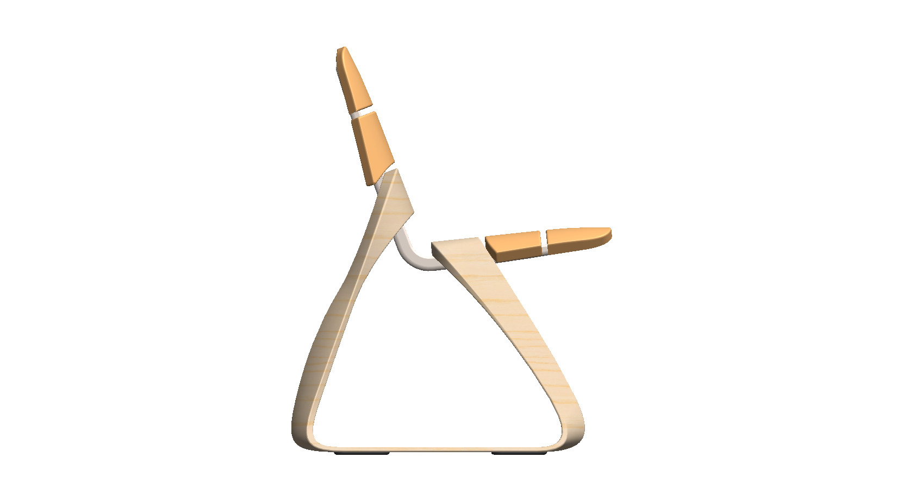
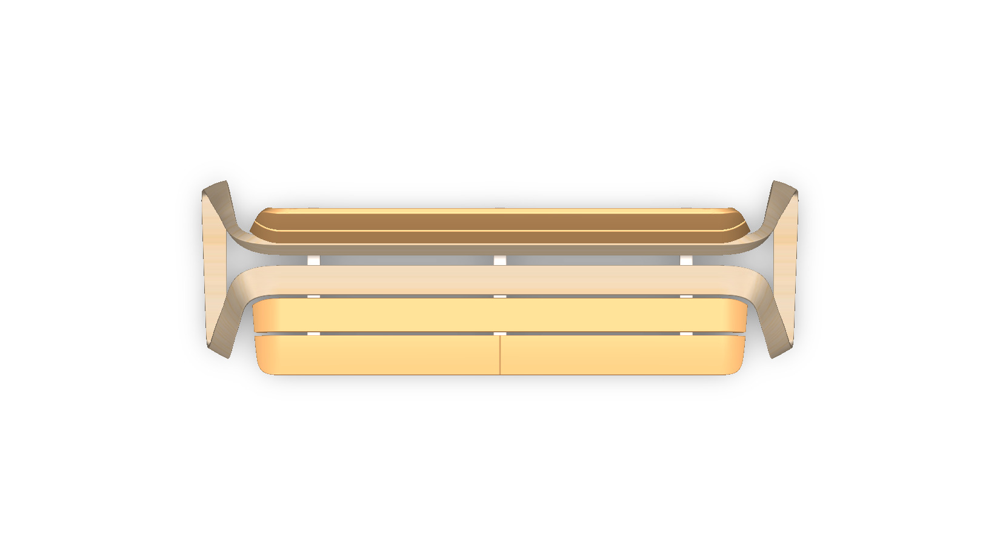
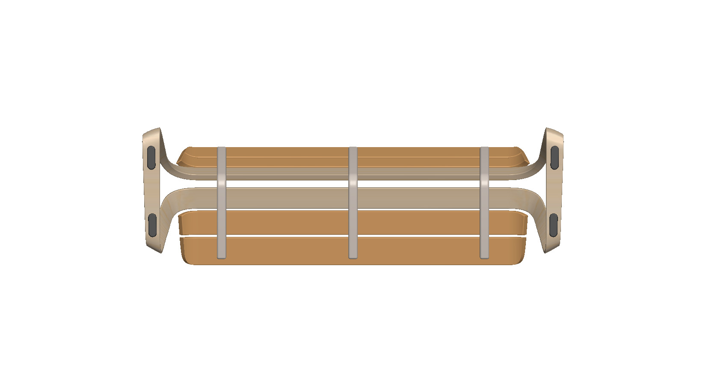
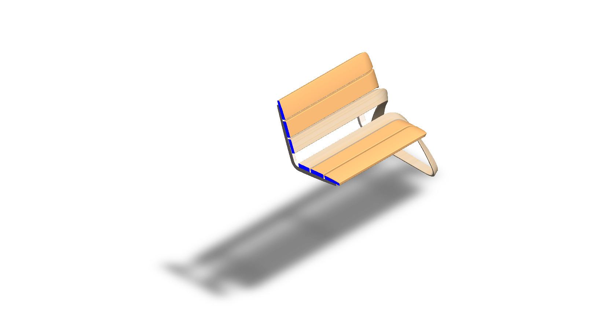
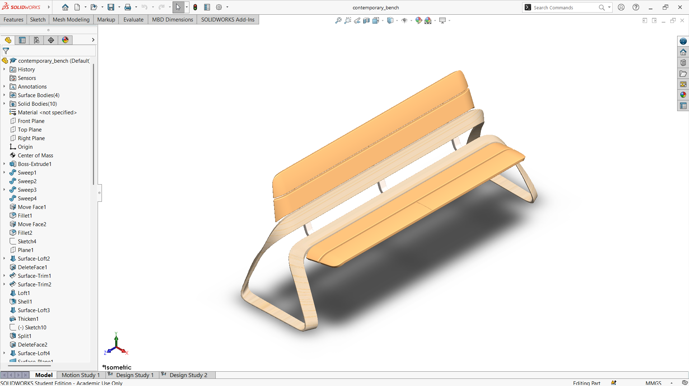

# A Looped-Frame Contemporary Bench with a Slatted Seat and Backrest

## Summary

A contemporary bench enables sitting in places, providing rest to human beings. From quiet gardens and busy entrances to public parks, a bench gives people a place to pause, wait, or simply enjoy their surroundings. Unlike a traditional bench, a contemporary bench combines comfort with clean, flowing lines, so it works as a piece of design as well as a seat [^1].

I followed a YouTube video to design it and added some tweaks of my own. The bench is built around two continuous, looped side frames that curve from the ground, up through the seat, and back toward the backrest. Between these frames, slim slats form the seat and the backrest, and the gaps between the slats give the surface a light, layered look. Following the video taught me the basic workflow, and my own tweaks, such as adjusting proportions and refining the details, helped me understand how each dimension changes the final form.

The bench was developed as a computational model in SolidWorks. The main challenge was to keep the curved frames smooth and symmetrical while the slats stay aligned with them, because a small error in one curve shifts the whole assembly. The views and the section view below show how the frames, seat, and backrest come together. This prototype is a base concept design that can be developed further into a real, buildable bench.

|          Name          |                        Image                         |
| :--------------------: | :--------------------------------------------------: |
| Contemporary Bench[^1] |  |

---

## Computational Design

|   View    |                              Image                              |
| :-------: | :-------------------------------------------------------------: |
| Isometric |  |
|   Left    |            |
|   Right   |          |
|   Back    |            |
|   Front   |          |
|    Top    |              |
|  Bottom   |        |
|  Section  |      |

---

## Software Used

| Purpose |               Name                |
| :-----: | :-------------------------------: |
| Design  | SolidWorks 2024 (Student Version) |

---

## Tools Used

| No  |      Name      |
| :-: | :------------: |
| 01  |  Boss Extrude  |
| 02  |     Sweep      |
| 03  |   Move Face    |
| 04  |     Fillet     |
| 05  |     Sketch     |
| 06  |     Plane      |
| 07  |  Surface Loft  |
| 08  |  Delete Face   |
| 09  |  Surface Trim  |
| 10  |      Loft      |
| 11  |     Shell      |
| 12  |    Thicken     |
| 13  |     Split      |
| 14  |  Surface Knit  |
| 15  |   Split Line   |
| 16  | Surface Extend |
| 17  |    Combine     |
| 18  |  Surface Cut   |
| 18  | Body Move/Copy |
| 18  |     Mirror     |

---

## Image of the Tool Used

| No  |                                    Image                                     |
| :-: | :--------------------------------------------------------------------------: |
| 01  |    |
| 02  |    |
| 03  |  |

---

## Applications [^2][^3]

- Entryway Seating
- Garden and Patio Bench
- Park and Public Space Seating
- Foot-of-Bed Bench
- Indoor Hallway Seating

---

## Design Limitations

The design of the bench was developed as a prototype product. That’s why the real-life design considerations, including usability, accessibility, weather resistance, material selection, load-bearing and structural validation, proper design specification, monetization, and feasibility, have not been included.

---

## Future Improvements

The bench was modeled as a geometric prototype. The next steps are selecting a real material (such as teak, powder-coated aluminum, or concrete), defining the joints and fasteners, and checking the seat under load with static simulation. Weather resistance, drainage for outdoor use, and the weight needed for stability should also be studied. A parametric length, height, and width would let the same model fit entryways, gardens, and public spaces.

---

## References

[^1]: [Real Contemporary Bench](https://unsplash.com/@ashenone77)

[^2]: [Modern garden benches](https://develop.gardenersworld.com/product-guides/outdoor-living/modern-garden-benches)

[^3]: [Nokk bench, metal, green, L 114 cm](https://www.madeindesign.co.uk/prod-nokk-bench-metal-green-l-114-cm-noo-ma-refm117385401.html)

---

## Acknowledgements

Special thanks to the [EasyCAD Solutions](https://www.youtube.com/@EasyCADSolutions) YouTube channel for the SolidWorks tutorials that helped in creating this design.
